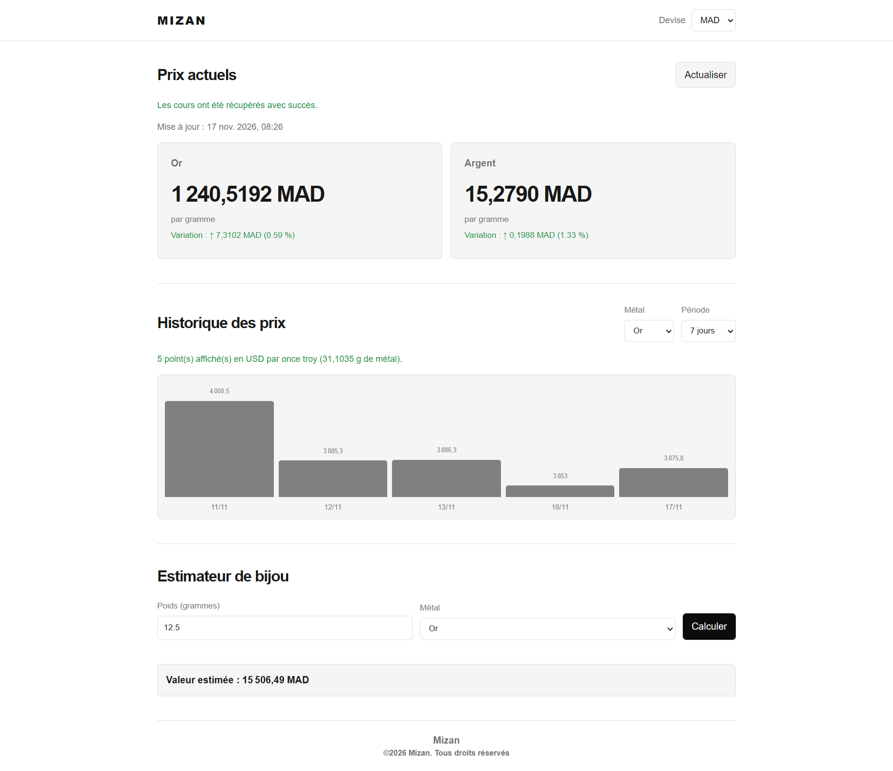
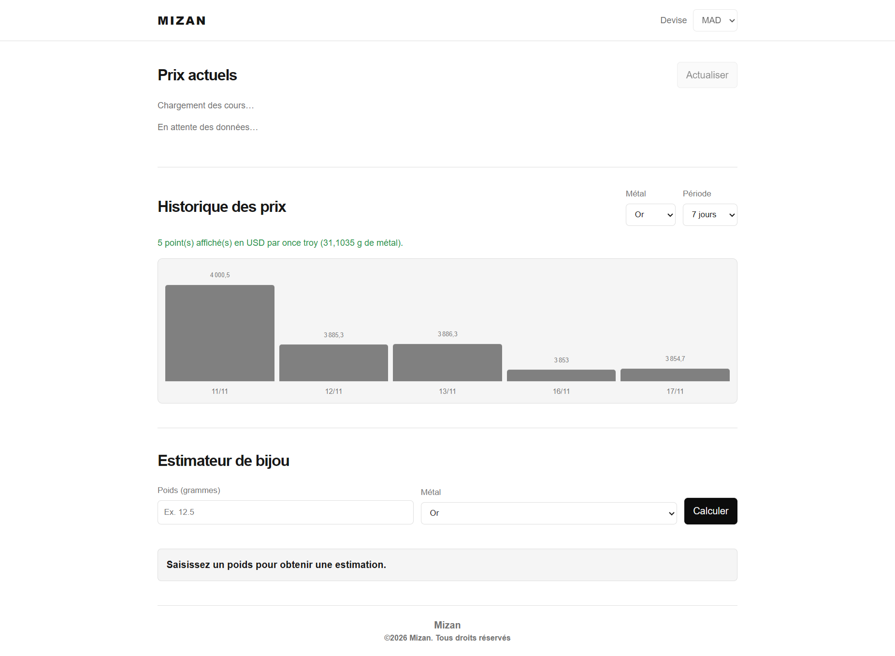
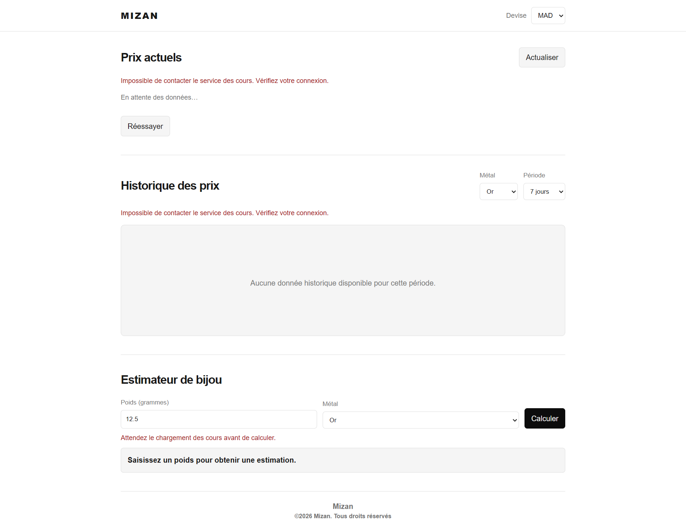
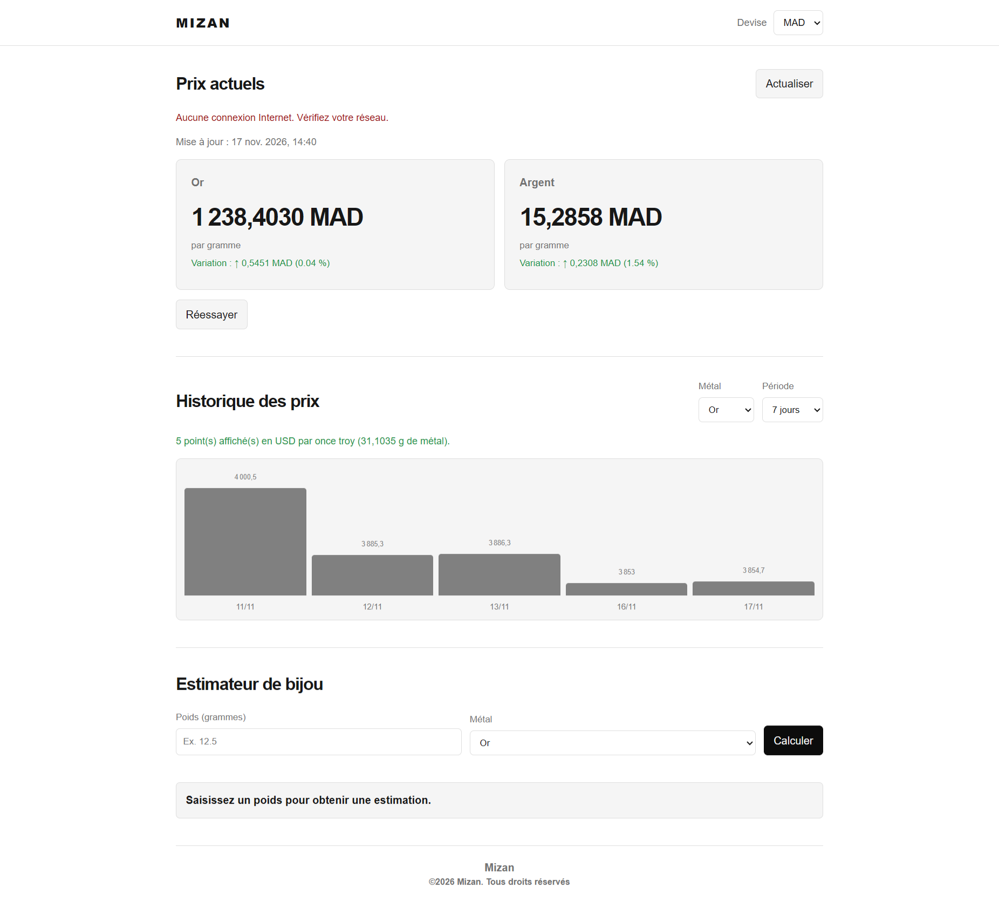

# Mizan

Application web de consultation des cours indicatifs de l'or et de l'argent et d'estimation d'un bijou selon son poids.

## Technologies

- HTML5 et CSS3
- JavaScript Vanilla avec modules ES
- Fetch API et localStorage
- XAUS API : https://xaus.com/api/

Aucun framework ni bibliothèque graphique ne sont utilisés.

## Lancement

Le projet utilise des modules JavaScript. Lancez-le avec un serveur HTTP local (par exemple Live Server dans VS Code), puis ouvrez `index.html` via ce serveur. L'ouverture directe en `file://` peut bloquer les modules ES ou les requêtes réseau.

## Fonctionnalités

- Prix spot de l'or et de l'argent en MAD, USD ou EUR.
- Changement de devise sans rechargement et mémorisation du choix.
- Variation calculée à partir des deux dernières clôtures quotidiennes disponibles.
- Historique de l'or ou de l'argent sur une fenêtre de 7 ou 30 jours.
- Graphique natif construit sans bibliothèque.
- Estimateur de valeur selon le poids en grammes.
- États de chargement, succès et erreur, avec possibilité de réessayer.

## Endpoints utilisés et paramètres

L'application utilise l'API XAUS pour récupérer les cours des métaux précieux.

### Prix actuels

`GET https://xaus.com/api/v1/spot`

Paramètres utilisés :
- `currency` : devise d'affichage (`MAD`, `USD` ou `EUR`).
- `unit` : unité de mesure (`gram`).
- `compact` : format de réponse (`1`).

### Historique des prix

`GET https://xaus.com/api/v1/chart`

Paramètres utilisés :
- `symbol` : métal demandé (`xau` pour l'or ou `silver` pour l'argent).
- `range` : période de l'historique (`1mo`).
- `interval` : fréquence des données (`1d`).

## Limites des données

Les prix sont indicatifs et ne constituent pas une cotation de transaction. Le calculateur estime le poids brut au cours spot ; il ne prend pas en compte la pureté, la fabrication ou les frais. Si l'API ne fournit pas assez de points historiques, la variation est indiquée comme indisponible au lieu d'être inventée.

L'API peut renvoyer des données périmées ou indisponibles. L'interface signale les états de fraîcheur et les erreurs connus.

## Architecture

- `js/api.js` : appels HTTP, cache des séries historiques, traitement des erreurs et journal des requêtes.
- `js/ui.js` : affichage DOM et formatage.
- `js/calculator.js` : fonction pure de calcul et validation du poids.
- `js/history.js` : sélection des points, variation et graphique natif.
- `js/main.js` : initialisation, événements et coordination des modules.

## Difficultés rencontrées et solutions

| Difficulté | Solution adoptée |
|---|---|
| Récupérer les données depuis l'API | Utilisation de `fetch()` avec `async/await`. |
| Gérer les erreurs de requête | Ajout de `try/catch` et de messages adaptés aux différents états. |
| Organiser le code JavaScript | Séparation des responsabilités dans plusieurs modules. |
| Calculer la valeur d'un bijou | Création d'une fonction de calcul indépendante de l'affichage. |
| Afficher les données de l'historique | Traitement des points reçus et création d'un graphique sans bibliothèque externe. |

## Vérifications effectuées

- Syntaxe JavaScript vérifiée avec Node.js.
- Fonction de calcul testée avec poids valides et invalides.
- Sélection des points historiques testée.
- Calcul de variation, pourcentage et direction testé.
- Comportement avec historique insuffisant testé.
- Fichiers JSON d'exemple validés.

## Tests réalisés dans le navigateur

1. Lancer le projet avec un serveur HTTP local.
2. Vérifier les cartes des deux métaux et leurs variations.
3. Changer MAD, USD et EUR ; vérifier l'actualisation sans rechargement.
4. Recharger la page et vérifier que la devise est conservée.
5. Basculer entre Or et Argent, puis entre 7 et 30 jours.
6. Tester le calcul avec un poids positif, zéro, vide, négatif et non numérique. Le zéro est accepté ; les champs vides, négatifs et non numériques sont refusés.
7. Couper le réseau dans les DevTools et vérifier le message d'erreur puis « Réessayer ».

## Captures d'écran

### Succès

### Chargement

### Erreur 

### Acune connexion

